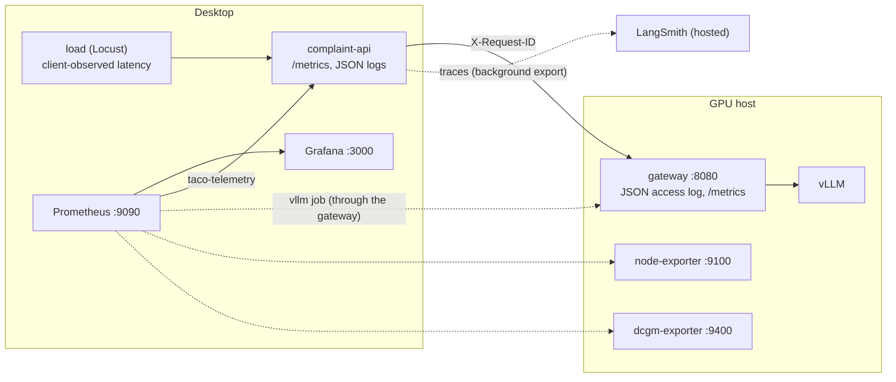

# Module 4: Monitoring and Tracing the Deployment

Runbooks for Demos 4.1 and 4.2. Module 4 starts the observability project (`taco-observe`) on the
desktop and the exporters on the GPU host, turns on LangSmith tracing for the complaint API, and adds
load generation and a baseline report. The application's metrics, structured logs, and trace hooks are
already in the app code; this module connects them.

| Demo | File | Outcome |
| --- | --- | --- |
| 4.1 | [demo-4.1-instrument-and-load.md](demo-4.1-instrument-and-load.md) | Metrics from both hosts in Grafana, normal and burst Locust traffic, client vs application vs server latency, a documented baseline |
| 4.2 | [demo-4.2-diagnose-with-traces.md](demo-4.2-diagnose-with-traces.md) | LangSmith traces of the workflow; a slow and a failing case API located in the trace, the logs, and the dashboards |

## Components used

| Folder | Used for |
| --- | --- |
| [observability/](../observability/README.md) | `prometheus` (scrape config, recording and alerting rules), `grafana` (three generated dashboards) |
| [model-host/](../model-host/README.md) | `node-exporter`, `dcgm-exporter` (or `nvidia-smi-exporter`); the gateway's JSON access log with the caller's request id |
| [app/](../app/README.md) | `complaint-api` metrics ([observability.py](../app/complaint_api/observability.py)), JSON logs, LangSmith settings in `app/.env`, `cli case-fault` |
| [tools/](../tools/README.md) | `load` (Locust) and `baseline` |
| [shared/](../shared/README.md) | request-id forwarding in `agent/model.py`, the `load-v1` selection in `load.py`, the synthetic reviewer `load-reviewer-01` |
| `results/` | `load/` (Locust CSV, HTML, outcomes, run metadata), `baseline/` |

## Where each signal comes from



| Layer | Metrics | Logs | Traces |
| --- | --- | --- | --- |
| Client (Locust) | stats CSV and HTML report in `results/load/` | - | - |
| Complaint API | `taco_*` on `/metrics` | `podman logs taco-app_complaint-api_1` (JSON, content-free) | LangSmith project `taco-alley` |
| Gateway | - | `podman logs gateway` on the GPU host (JSON, same `request_id`) | - |
| vLLM | `vllm:*` through the gateway | - | - |
| GPU host | `node_*`, `DCGM_FI_*` | - | - |

## Setup

### GPU host (once)

```bash
cd ~/Deploying-and-Operating-Small-Language-Model-Systems      # your clone
source model-host/env.sh
echo "$MODEL_HOST"                                             # must be the LAN address the desktop uses

# 1. Gateway: JSON access log with the caller's request id.
podman exec gateway nginx -t
curl -s -D - -o /dev/null -H 'X-Request-ID: check-1' "http://$MODEL_HOST:8080/v1/models" | grep -i x-request-id
podman logs --tail 1 gateway

# 2. Exporters, bound to MODEL_HOST only
podman compose up -d node-exporter dcgm-exporter
curl -s "http://$MODEL_HOST:9100/metrics" | grep -c '^node_cpu_seconds_total'
curl -s "http://$MODEL_HOST:9400/metrics" | grep -E '^DCGM_FI_DEV_(GPU_UTIL|FB_USED|POWER_USAGE)'
```

The `curl` should print `X-Request-ID: check-1`, and the last log line should be JSON with
`"request_id":"check-1"`. If `dcgm-exporter` cannot read the GPU, use the fallback described in
[model-host/README.md](../model-host/README.md#services).

### Desktop (WSL)

```bash
# Application: LangSmith settings in app/.env (LANGSMITH_TRACING=true, LANGSMITH_API_KEY), then recreate
cd app
APP_VERSION=$(git rev-parse --short HEAD) podman-compose build
podman-compose up -d --force-recreate case-api complaint-api

# Observability
cd ../observability
cp .env.example .env              # MODEL_HOST
printf '%s' "$(openssl rand -hex 16)" > ../secrets/grafana_admin_password
podman-compose up -d prometheus grafana

# Load and baseline one-shots
cd ../tools
podman-compose build
```

Prometheus is at `http://127.0.0.1:9090` and Grafana at `http://127.0.0.1:3000` (see
[observability/README.md](../observability/README.md)).

## Local tracing alternative (discussion only)

LangSmith is a hosted service: traces, including complaint text and model outputs, leave the
deployment. That is acceptable here because every record is synthetic, and the redaction switches
(`LANGSMITH_HIDE_INPUTS`, `LANGSMITH_HIDE_OUTPUTS`) keep content out while preserving structure and
timings. A deployment that may not export traces would keep them local instead:

```
complaint-api (OpenTelemetry SDK, or LangSmith's OTel export / OpenLLMetry instrumentation)
  -> OpenTelemetry Collector (desktop) -> Grafana Tempo -> Grafana (traces next to these metrics)
```

The trade-offs: you operate and secure the trace store and its retention, and you lose LangSmith's
LLM-specific views (prompt/response panes, threads, evaluations). Nothing for this path ships with the
course.

## Teardown

```bash
cd observability && podman-compose stop prometheus grafana  # monitoring history stays in the volumes
podman compose stop node-exporter dcgm-exporter             # on the GPU host, with model-host/env.sh sourced
```

Stopping `taco-observe` never stops complaint processing (Demo 4.1 shows this). Never use
`podman-compose down --volumes` for routine shutdown: it deletes the monitoring history.
