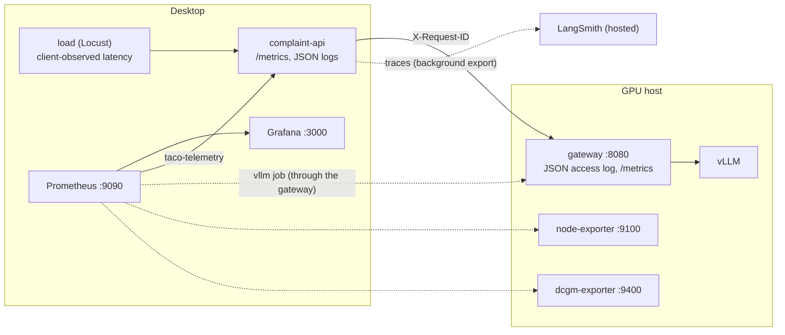

# Module 4: Monitoring and Tracing the Deployment

Commands and configuration for Demos 4.1 and 4.2. Module 4 adds an independent observability project
(`taco-observe`) on the desktop, exporters on the GPU host, and LangSmith tracing for the complaint
API. The application keeps running from `m3/`: its metrics, structured logs, and trace hooks ship with
the module 3 code, and this module connects them.

| Demo | File | Outcome |
| --- | --- | --- |
| 4.1 | [demo-4.1-instrument-and-load.md](demo-4.1-instrument-and-load.md) | Metrics from both hosts in Grafana, normal and burst Locust traffic, client vs application vs server latency, a documented baseline |
| 4.2 | [demo-4.2-diagnose-with-traces.md](demo-4.2-diagnose-with-traces.md) | LangSmith traces of the workflow; a slow and a failing case API located in the trace, the logs, and the dashboards |

## Layout

```
m4/
  compose.yaml              project taco-observe (desktop): prometheus, grafana, load, baseline
  .env.example              MODEL_HOST, ports, direct-load model settings, admin token, LangSmith
  secrets/README.md         grafana_admin_password (git-ignored)
  prometheus/
    prometheus.yml          jobs complaint-api, vllm, node, gpu, prometheus (stable job/instance labels)
    start.sh                writes the model-host file_sd targets from MODEL_HOST, then starts Prometheus
    rules/taco.yml          recording rules (normalized GPU, latency percentiles) and alerting thresholds
  grafana/
    build_dashboards.py     generates the three dashboards (edit here, then rerun)
    dashboards/             model-serving.json, model-host.json, complaint-workflow.json
    provisioning/           Prometheus data source and dashboard provider
  load/
    Containerfile           python:3.12-slim + shared[load] (Locust 2.46.7)
    locustfile.py           direct and app workloads; steady and burst shapes
    run.py                  resets load cases, runs Locust headless, writes results and run metadata
  eval/
    baseline_report.py      Prometheus over a run window + Locust numbers -> baseline .json and .md
  model-host/
    compose.yaml            project taco-model-exporters (GPU host): node-exporter, dcgm-exporter,
                            nvidia-smi-exporter (fallback)
    dcgm-counters.csv       the GPU fields a GeForce card reports
  results/                  generated output (git-ignored)
```

Module 4 also changed code that earlier modules run (all additive; module 3 runbooks are unchanged):

| File | Change |
| --- | --- |
| `m1/gateway/nginx.conf` | keeps a caller's `X-Request-ID`, returns it, logs JSON lines with timings; `/metrics` scrapes are not logged |
| `m3/compose.yaml` | `complaint-api` joins the external `taco-telemetry` network, reads `LANGSMITH_*` from `TRACING_ENV_FILE`, gets working healthchecks |
| `m3/app/observability.py` | `taco_build_info`, run-slot and queue metrics, `error_kind` on tool calls, `tool_call`/`model_call` log lines |
| `m3/app/service.py` | bounded concurrent runs (`WORKFLOW_MAX_CONCURRENT_RUNS`), per-case locking, LangSmith run names, tags, and metadata |
| `shared/taco_shared/agent/model.py` | forwards the request id to the gateway on every model call |
| `shared/taco_shared/load.py` | the `load-v1` case selection and the direct-inference request bodies |
| `shared/taco_shared/data/actors.json` | `load-reviewer-01`, a synthetic reviewer used only by Locust (hidden from the review page) |

## Where each signal comes from



| Layer | Metrics | Logs | Traces |
| --- | --- | --- | --- |
| Client (Locust) | stats CSV and HTML report in `results/` | - | - |
| Complaint API | `taco_*` on `/metrics` | `podman logs taco-app_complaint-api_1` (JSON, content-free) | LangSmith project `taco-alley` |
| Gateway | - | `podman logs gateway` on the GPU host (JSON, same `request_id`) | - |
| vLLM | `vllm:*` through the gateway | - | - |
| GPU host | `node_*`, `DCGM_FI_*` | - | - |

## Setup

### GPU host (once)

The repository must be up to date on the GPU host (the gateway config changed).

```bash
cd ~/Deploying-and-Operating-Small-Language-Model-Systems      # your clone
git pull                                                       # or copy m1/gateway/nginx.conf and m4/model-host/
source m1/env.sh
echo "$MODEL_HOST"                                             # must be the LAN address the desktop uses

# 1. Gateway: JSON access log with the caller's request id. A restart re-reads the bind-mounted file.
podman restart gateway
podman exec gateway nginx -t
curl -s -D - -o /dev/null -H 'X-Request-ID: check-1' "http://$MODEL_HOST:8080/v1/models" | grep -i x-request-id
podman logs --tail 1 gateway

# 2. Exporters, bound to MODEL_HOST only
podman compose -f m4/model-host/compose.yaml up -d node-exporter dcgm-exporter
curl -s "http://$MODEL_HOST:9100/metrics" | grep -c '^node_cpu_seconds_total'
curl -s "http://$MODEL_HOST:9400/metrics" | grep -E '^DCGM_FI_DEV_(GPU_UTIL|FB_USED|POWER_USAGE)'
```

The `curl` should print `X-Request-ID: check-1`, and the last log line should be JSON with
`"request_id":"check-1"`.

If `dcgm-exporter` exits or the `DCGM_FI_DEV_*` lines are missing (driver or DCGM version mismatch),
use the fallback; the dashboards read the same recording rules either way:

```bash
podman compose -f m4/model-host/compose.yaml stop dcgm-exporter
podman compose -f m4/model-host/compose.yaml up -d nvidia-smi-exporter
curl -s "http://$MODEL_HOST:9400/metrics" | grep -E '^nvidia_smi_(utilization_gpu_ratio|memory_used_bytes)'
```

The exporters have no authentication in modules 4-5. They listen on `MODEL_HOST` only; if the GPU host
runs a firewall, allow 9100 and 9400 from the desktop's address only. Module 6 revisits metrics access.

### Desktop (WSL)

```bash
cd m4
cp .env.example .env              # MODEL_HOST, INFERENCE_MODEL/EXTRA_BODY and TACO_ADMIN_TOKEN as in m3/.env,
                                  # LangSmith API key; values unquoted
printf '%s' "$(openssl rand -hex 16)" > secrets/grafana_admin_password
podman network exists taco-telemetry || podman network create taco-telemetry

# Application: tracing settings and the telemetry network (from m3/)
cd ../m3
grep -q '^TRACING_ENV_FILE=' .env || echo 'TRACING_ENV_FILE=../m4/.env' >> .env
APP_VERSION=$(git rev-parse --short HEAD) podman-compose build complaint-api case-api
podman-compose up -d --force-recreate case-api complaint-api

# Observability (from m4/)
cd ../m4
podman-compose build load
podman-compose up -d prometheus grafana
```

Prometheus is at `http://127.0.0.1:9090` and Grafana at `http://127.0.0.1:3000` (anonymous read-only;
log in as `admin` with the password file to edit). With `PUBLISH_ADDRESS=0.0.0.0` (see the WSL note in
[../m3/README.md](../m3/README.md#browser-on-windows-podman-in-wsl)), browse to the WSL address instead.

The complaint API reads `m4/.env` with `podman --env-file`, which passes values literally: do not quote
them. It also receives the other variables in that file; the explicit `environment:` entries in
`m3/compose.yaml` take precedence for the inference settings.

## Services

| Project | Service | Kind | What it does |
| --- | --- | --- | --- |
| taco-observe | `prometheus` | long-running | scrapes `complaint-api` over `taco-telemetry` and the GPU host over the LAN every 5 s; 30 days in `taco-observe-prometheus` |
| taco-observe | `grafana` | long-running | three provisioned dashboards in the "Taco Alley" folder; state in `taco-observe-grafana` |
| taco-observe | `load` | one-shot | `load/run.py`: `--mode direct|app`, `--shape steady|burst`, `--users`, `--burst-users`, `--duration`, `--label` |
| taco-observe | `baseline` | one-shot | `eval/baseline_report.py [meta.json] [--label]` (default: the newest run) |
| taco-model-exporters | `node-exporter`, `dcgm-exporter`, `nvidia-smi-exporter` | long-running (GPU host) | host and GPU metrics on `MODEL_HOST:9100` and `:9400` |

The `load` service joins `taco-app-private` as a client of the complaint API (like the module 3 CLI)
and reaches the gateway over the LAN. App mode resets the `load-v1` cases on both APIs before each run,
so runs are repeatable and module 2/3 fixtures are untouched.

## Local tracing alternative (discussion only)

LangSmith is a hosted service: traces, including complaint text and model outputs, leave the
deployment. That is acceptable here because every record is synthetic, and the redaction switches
(`LANGSMITH_HIDE_INPUTS`, `LANGSMITH_HIDE_OUTPUTS`) keep content out while preserving structure and
timings. A deployment that may not export traces would keep them local instead:

```
complaint-api (OpenTelemetry SDK, or LangSmith's OTel export / OpenLLMetry instrumentation)
  -> OpenTelemetry Collector (desktop) -> Grafana Tempo -> Grafana (traces next to these metrics)
```

The trade-offs: you operate and secure the trace store and its retention, and you lose LangSmith's
LLM-specific views (prompt/response panes, threads, evaluations). Nothing for this path ships with the
course.

## Teardown

```bash
podman-compose stop prometheus grafana                       # monitoring history stays in the volumes
podman compose -f m4/model-host/compose.yaml stop            # on the GPU host
```

Stopping `taco-observe` never stops complaint processing (Demo 4.1 shows this). Never use
`podman-compose down --volumes` for routine shutdown: it deletes the monitoring history.
